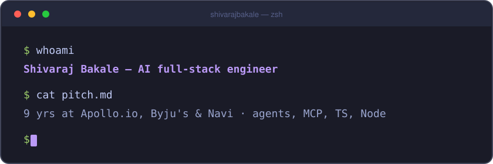

  

 

<table>
  <tr>
    <td width="33%" valign="top" align="center">
      <a href="https://github.com/shivarajbakale/kitestring"><b>🪁 kitestring</b></a> 
      Let AI agents drive your real Chrome — every action returns a status, a diff and a page brief.  
      
      
    </td>
    <td width="33%" valign="top" align="center">
      <a href="https://github.com/shivarajbakale/hatch"><b>🚀 hatch</b></a> 
      Deploy Node apps to every region from your own AWS account — one command.  
      
      
    </td>
    <td width="33%" valign="top" align="center">
      <a href="https://github.com/shivarajbakale/offerlab"><b>🧪 offerlab</b></a> 
      Interview prep you can watch run — the NeetCode 150 and system design, step by step.  
      
      
    </td>
  </tr>
</table>

 

  
  

 

  

 

  <samp>🏠 working from home</samp>&nbsp;&nbsp;·&nbsp;&nbsp;<a href="https://shivarajbakale.com"><samp>shivarajbakale.com</samp></a>

