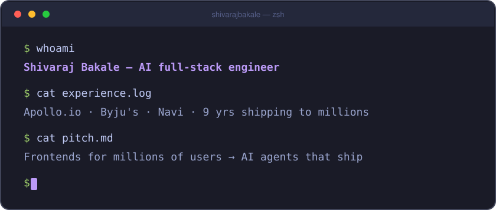

  

 

  
  
  
  
  

 

<table>
  <tr>
    <td width="33%" valign="top" align="center">
      <a href="https://github.com/shivarajbakale/kitestring"><b>🪁 kitestring</b></a> 
      Let AI agents drive your real Chrome — every action returns a status, a diff and a page brief. MCP server + CLI + MV3 extension.  
      
      
    </td>
    <td width="33%" valign="top" align="center">
      <a href="https://github.com/shivarajbakale/hatch"><b>🚀 hatch</b></a> 
      Deploy Node apps to every region from your own AWS account — one command on Lambda Web Functions, CloudFront included.  
      
      
    </td>
    <td width="33%" valign="top" align="center">
      <a href="https://github.com/shivarajbakale/offerlab"><b>🧪 offerlab</b></a> 
      Interview prep you can watch run — the NeetCode 150 and system design as live, step-by-step simulations.  
      
      
    </td>
  </tr>
  <tr>
    <td colspan="3" valign="top" align="center">
       
      <a href="https://github.com/shivarajbakale/lexicard"><b>🃏 lexicard</b></a> 
      Swipe to learn the words, idioms and phrases people actually use — 2,051 cards with real-life examples, honest origin stories, spaced repetition and levels. Installable PWA.  
      
      
      
    </td>
  </tr>
</table>

 

  
  

 

  

 

  📮 <b>Open to AI full-stack roles</b> · India &amp; remote 
  <a href="mailto:shivarajapple@gmail.com">shivarajapple@gmail.com</a> · <a href="https://shivarajbakale.com">shivarajbakale.com</a> · <a href="https://www.linkedin.com/in/shivaraj-bakale-aba787114/">LinkedIn</a>

